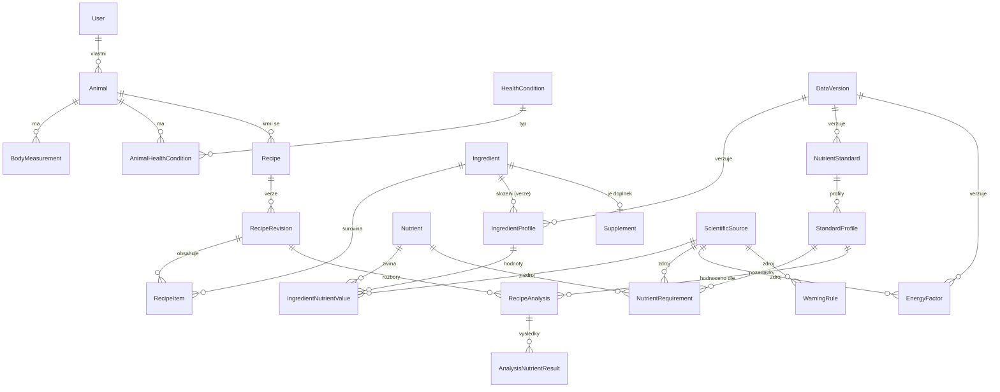

# 7. Technická architektura a databázové schéma Django

> Celá kapitola je 🛠 pracovní návrh (technická rozhodnutí, ne odborná tvrzení). Kde se schéma opírá
> o odbornou logiku, odkazuje na příslušnou kapitolu.
>
> **Stav implementace 🛠:** hotové jsou aplikace `accounts` (účty, role, GDPR) a `animals` (modely
> `Animal`, `BodyMeasurement`, `HealthCondition`, `AnimalHealthCondition`, `AnimalShare` s historií
> změn, **bez nutričních vazeb**), viz [12](12-ucty-a-zvirata.md). `catalog`, `standards`, `recipes`,
> `analyses`, REST API a HTMX zatím nejsou.

## 7.1 Architektura ve vrstvách

```
┌───────────────────────────────────────────────────────────────────────┐
│ Prezentace: Django šablony + HTMX (server-rendered), PDF export       │
│ API: Django REST Framework (/api/v1/…) pro budoucí klienty a integrace│
├───────────────────────────────────────────────────────────────────────┤
│ Aplikační služby (Django): načtení dat → sestavení snapshotu →        │
│ volání jádra → uložení neměnného výsledku → audit                     │
├───────────────────────────────────────────────────────────────────────┤
│ Výpočetní jádro `nutricalc` (čistý Python, bez Djanga a bez I/O):     │
│ units · energy · composition · requirements · evaluation · rules ·    │
│ optimizer (fáze 5)                                                    │
├───────────────────────────────────────────────────────────────────────┤
│ PostgreSQL 16+: verzovaná referenční data, uživatelská data, audit    │
└───────────────────────────────────────────────────────────────────────┘
```

**Proč takto:**
- Jádro bez Djanga lze testovat rychle a izolovaně. Stejné jádro lze později použít v CLI, ve validačních
  skriptech pro specialistu nebo v jiném frontendu.
- Volím server-rendered UI s HTMX místo SPA. Pro odbornou aplikaci s formuláři a tabulkami je to méně
  komponent a jeden jazyk, což odpovídá požadavku „nezaváděj zbytečně složitou architekturu".
  Pokud vznikne potřeba bohatšího klienta, REST API je připravené.
- Celery a fronty v MVP nejsou potřeba (výpočet trvá milisekundy). Asynchronně se bude řešit až import
  velkých datasetů a export PDF.

### Struktura repozitáře (návrh)

```
pet_app/
  nutricalc/               # výpočetní jádro (pip-instalovatelný balíček, vlastní testy)
    errors.py  decimal_ctx.py  vocab.py  flags.py  units.py  energy.py  composition.py  me.py
    requirements.py  evaluation.py  rules.py  gate.py  snapshot.py  analysis.py
  refdata/                 # kontrola dvojího přepisu tabulek standardů (čistý Python, `python -m refdata`)
  backend/
    config/                # settings, urls
    accounts/  animals/  catalog/  standards/  recipes/  analyses/  audit/  importers/
  data/reference/          # šablony importu, katalog živin (CSV), nikoli schválená data
  docs/
  tests/                   # integrační a referenční (golden) testy
```

## 7.2 Determinismus a reprodukovatelnost

Požadavek: **stejný vstup + stejné verze dat a jádra = bitově stejný výsledek.**

| Opatření | Jak |
|---|---|
| Neměnný vstup | Před výpočtem se sestaví `AnalysisInput` (frozen dataclass) se všemi hodnotami, které výpočet použije, včetně čísel ze schválených verzí dat. Jádro nečte z databáze |
| Kanonická serializace | JSON se seřazenými klíči, Decimal jako řetězec, bez plovoucí řádové čárky → `input_hash = SHA-256` |
| Aritmetika | `decimal.Decimal`, lokální kontext (přesnost 28, `ROUND_HALF_EVEN`). Žádné `float` v jádře (vynuceno lintem a testem) |
| Pořadí | Suroviny i živiny se zpracovávají v pořadí seřazeném podle `uuid` a `code`. Výsledek nezávisí na pořadí zadání (test) |
| Verze dat | `DataVersion` ve stavu `APPROVED` je neměnná. Opravy vznikají jako nová verze |
| Verze jádra | `nutricalc.__version__` (SemVer) se ukládá do výsledku. Změna výpočetní logiky = nová minor nebo major verze + aktualizace golden testů se schválením |
| Uložení výsledku | `RecipeAnalysis` je append-only: vstupní snapshot, výsledek, hash, verze. Přepočet = nový záznam |
| Ověření | Příkaz `verify_analysis <id>` přepočítá uložený snapshot aktuálním jádrem dané verze a porovná hash výsledku |
| Optimalizace | Pevná verze solveru, tolerance a seřazení proměnných. Výsledek optimalizátoru se vždy znovu analyzuje deterministickým jádrem |

## 7.3 ER diagram (zjednodušený)



## 7.4 Modely (návrh kódu, zkráceno)

Cílová verze: **Django 5.2 LTS** + DRF + PostgreSQL. Zkratka v ukázce: `D(**kw)` znamená
`models.DecimalField(max_digits=18, decimal_places=8, **kw)`. Všechny modely mají `created_at`, `updated_at`, `created_by` (abstraktní
`TimeStamped`).

```python
# catalog/models.py ----------------------------------------------------------
class ScientificSource(TimeStamped):
    citation_key = models.SlugField(unique=True)            # "FEDIAF2025"
    title = models.TextField()
    authors_or_org = models.TextField()
    year = models.PositiveSmallIntegerField()
    doi = models.CharField(max_length=200, blank=True)
    url = models.URLField(blank=True)
    source_type = models.CharField(choices=SourceType.choices)   # GUIDELINE, REVIEW, FOOD_DATABASE…
    evidence_level = models.CharField(choices=EvidenceLevel.choices)  # L1–L6
    species = models.CharField(choices=SpeciesScope.choices)     # DOG, CAT, BOTH, NA
    life_stages = ArrayField(models.CharField(max_length=40), default=list)
    units_and_conditions = models.TextField(blank=True)
    edition_version = models.CharField(max_length=100, blank=True)
    verification_level = models.CharField(choices=VerificationLevel.choices)  # B, A, P, S, NONE
    last_verified_at = models.DateField(null=True)
    verified_by = models.ForeignKey(User, null=True, on_delete=models.PROTECT, related_name="+")
    limitations = models.TextField(blank=True)

class DataVersion(TimeStamped):
    """Neměnná verze referenčních dat. Po APPROVED nelze měnit (save() i DB trigger)."""
    scope = models.CharField(choices=Scope.choices)   # INGREDIENTS, STANDARDS, ENERGY, RULES
    label = models.CharField(max_length=50)           # "ingredients-2026.1"
    status = models.CharField(choices=Status.choices) # DRAFT → IN_REVIEW → APPROVED → RETIRED
    approved_by = models.ForeignKey(User, null=True, on_delete=models.PROTECT, related_name="+")
    approved_at = models.DateTimeField(null=True)
    content_checksum = models.CharField(max_length=64, blank=True)  # SHA-256 obsahu při schválení
    changelog = models.TextField(blank=True)
    supersedes = models.ForeignKey("self", null=True, on_delete=models.PROTECT)
    class Meta:
        constraints = [models.UniqueConstraint(fields=["scope", "label"], name="uniq_scope_label")]

class Nutrient(TimeStamped):
    code = models.SlugField(unique=True)               # "CA", "VIT_D", "TAURINE"
    name_cs = models.CharField(max_length=120)
    category = models.CharField(choices=NutrientCategory.choices)  # MACRO, AMINO, FATTY_ACID, MINERAL, TRACE, VITAMIN, OTHER
    canonical_unit = models.CharField(choices=Unit.choices)        # G, MG, UG, KCAL
    display_decimals = models.PositiveSmallIntegerField(default=2)
    external_codes = models.JSONField(default=dict)     # {"fdc": "1087", "infoods": "CA"} – ověřit při importu
    is_ratio = models.BooleanField(default=False)       # CA_P

class Ingredient(TimeStamped):
    uuid = models.UUIDField(default=uuid4, unique=True, editable=False)
    code = models.SlugField(unique=True)
    name_cs = models.CharField(max_length=200)
    category = models.CharField(choices=IngredientCategory.choices)  # MUSCLE, HEART, LIVER, MEATY_BONE…
    animal_species = models.CharField(max_length=60, blank=True)
    anatomical_part = models.CharField(max_length=120, blank=True)
    preparation_state = models.CharField(choices=PreparationState.choices)
    contains_bone = models.BooleanField(default=False)
    safety_flags = ArrayField(models.CharField(max_length=40), default=list)
    allergen_tags = ArrayField(models.CharField(max_length=40), default=list)
    is_supplement = models.BooleanField(default=False)

class IngredientProfile(TimeStamped):
    """Složení suroviny v jedné verzi dat. Jedna surovina může mít více profilů (zdroje)."""
    ingredient = models.ForeignKey(Ingredient, on_delete=models.PROTECT, related_name="profiles")
    data_version = models.ForeignKey(DataVersion, on_delete=models.PROTECT)
    primary_source = models.ForeignKey(ScientificSource, on_delete=models.PROTECT)
    basis_note = models.TextField()                    # "na 100 g podávané hmoty vč. kosti"
    bone_fraction_pct = D(null=True)                   # u MEATY_BONE; bez zdroje NULL
    bone_fraction_source = models.ForeignKey(ScientificSource, null=True, on_delete=models.PROTECT, related_name="+")
    class Meta:
        constraints = [models.UniqueConstraint(fields=["ingredient", "data_version", "primary_source"],
                                               name="uniq_profile")]

class IngredientNutrientValue(models.Model):
    profile = models.ForeignKey(IngredientProfile, on_delete=models.CASCADE, related_name="values")
    nutrient = models.ForeignKey(Nutrient, on_delete=models.PROTECT)
    value = D(null=True)                               # NULL = neznámo (nikdy 0!)
    value_kind = models.CharField(choices=ValueKind.choices)   # MEASURED, BELOW_LOD, MISSING…
    value_min = D(null=True); value_max = D(null=True); sd = D(null=True); n = models.IntegerField(null=True)
    lod = D(null=True)
    original_value = D(null=True); original_unit = models.CharField(max_length=20, blank=True)
    original_basis = models.CharField(max_length=30, blank=True)
    source = models.ForeignKey(ScientificSource, on_delete=models.PROTECT)
    source_record = models.CharField(max_length=100, blank=True)  # FDC ID / číslo živiny
    method = models.CharField(max_length=200, blank=True)
    quality_grade = models.CharField(choices=QualityGrade.choices)  # A–D
    borrowed_from = models.ForeignKey("self", null=True, on_delete=models.PROTECT)
    class Meta:
        constraints = [
            models.UniqueConstraint(fields=["profile", "nutrient"], name="uniq_value"),
            # MISSING ⇔ value IS NULL; ZERO_BY_DEFINITION ⇒ value = 0
            models.CheckConstraint(name="missing_has_no_value", condition=(
                Q(value_kind="MISSING", value__isnull=True) | ~Q(value_kind="MISSING"))),
            models.CheckConstraint(name="non_missing_has_value", condition=(
                Q(value_kind="MISSING") | Q(value__isnull=False))),
            models.CheckConstraint(name="range_ordered", condition=(
                Q(value_min__isnull=True) | Q(value_max__isnull=True) | Q(value_min__lte=F("value_max")))),
        ]

class Supplement(models.Model):
    ingredient = models.OneToOneField(Ingredient, on_delete=models.CASCADE, primary_key=True)
    product_name = models.CharField(max_length=200); manufacturer = models.CharField(max_length=200, blank=True)
    chemical_form = models.CharField(max_length=200, blank=True)    # "cholekalciferol", "CaCO3"
    dose_unit = models.CharField(max_length=20)                      # "g", "tableta"
    grams_per_dose_unit = D(null=True)
    max_daily_dose_per_kg_bw = D(null=True)
    requires_vet = models.BooleanField(default=False)

# standards/models.py ---------------------------------------------------------
class NutrientStandard(TimeStamped):
    code = models.SlugField()                          # "FEDIAF"
    edition = models.CharField(max_length=30)          # "2025"
    source = models.ForeignKey(ScientificSource, on_delete=models.PROTECT)
    data_version = models.ForeignKey(DataVersion, on_delete=models.PROTECT)

class StandardProfile(TimeStamped):
    standard = models.ForeignKey(NutrientStandard, on_delete=models.PROTECT, related_name="profiles")
    species = models.CharField(choices=Species.choices)                 # DOG / CAT
    life_stage = models.CharField(choices=LifeStage.choices)            # ADULT_MAINTENANCE…
    reference_energy_k = D()                                            # 110
    reference_energy_exponent = D()                                     # 0.75
    basis = models.CharField(choices=Basis.choices)                     # PER_1000KCAL_ME
    mandatory_nutrients = models.ManyToManyField(Nutrient, related_name="+")  # pro souhrnný stav
    class Meta:
        constraints = [models.UniqueConstraint(
            fields=["standard", "species", "life_stage", "reference_energy_k"], name="uniq_std_profile")]

class NutrientRequirement(models.Model):
    profile = models.ForeignKey(StandardProfile, on_delete=models.CASCADE, related_name="requirements")
    nutrient = models.ForeignKey(Nutrient, on_delete=models.PROTECT)
    requirement_type = models.CharField(choices=RequirementType.choices)
    #   MIN_RECOMMENDED, MR, AI, RA, NUTRITIONAL_MAX, LEGAL_MAX_EU, SUL, RATIO_MIN, RATIO_MAX
    value = D()
    unit = models.CharField(choices=Unit.choices)
    condition_note = models.CharField(max_length=200, blank=True)  # např. „vlhké krmivo" u taurinu
    source = models.ForeignKey(ScientificSource, on_delete=models.PROTECT)
    source_table = models.CharField(max_length=40); source_page = models.CharField(max_length=20)
    transcribed_by = models.ForeignKey(User, on_delete=models.PROTECT, related_name="+")
    verified_by = models.ForeignKey(User, null=True, on_delete=models.PROTECT, related_name="+")
    class Meta:
        constraints = [models.UniqueConstraint(
            fields=["profile", "nutrient", "requirement_type", "condition_note"], name="uniq_requirement")]

class EnergyFactor(models.Model):
    data_version = models.ForeignKey(DataVersion, on_delete=models.PROTECT)
    species = models.CharField(choices=Species.choices)
    situation_code = models.SlugField()               # "ADULT_MODERATE_ACTIVITY"
    equation = models.CharField(choices=Equation.choices)  # MER_POWER, NRC_PUPPY, NRC_KITTEN…
    k = D(); exponent = D(); k_low = D(null=True); k_high = D(null=True)
    source = models.ForeignKey(ScientificSource, on_delete=models.PROTECT)
    note = models.TextField(blank=True)

class WarningRule(models.Model):
    data_version = models.ForeignKey(DataVersion, on_delete=models.PROTECT)
    code = models.SlugField()
    species = models.CharField(choices=SpeciesScope.choices)
    level = models.CharField(choices=WarningLevel.choices)  # INFO, NUTRITION_WARNING, EXPERT_REQUIRED, BLOCKED
    condition = models.JSONField()                          # deklarativní podmínka, ne kód
    message_cs = models.TextField()
    source = models.ForeignKey(ScientificSource, on_delete=models.PROTECT)

# animals/models.py -------------------------------------------------------------
class Animal(TimeStamped):
    owner = models.ForeignKey(User, on_delete=models.CASCADE, related_name="animals")
    name = models.CharField(max_length=100)
    species = models.CharField(choices=Species.choices)
    sex = models.CharField(choices=Sex.choices); neutered = models.BooleanField()
    birth_date = models.DateField(null=True); birth_date_estimated = models.BooleanField(default=False)
    breed = models.CharField(max_length=100, blank=True); size_category = models.CharField(choices=SizeCategory.choices, blank=True)
    expected_adult_weight_kg = D(null=True)
    target_weight_kg = D(null=True)
    target_weight_status = models.CharField(choices=TargetStatus.choices, default="UNVERIFIED")  # / VET_CONFIRMED
    activity_level = models.CharField(choices=Activity.choices)
    physiological_state = models.CharField(choices=PhysState.choices)  # MAINTENANCE, GROWTH, GESTATION, LACTATION
    current_feeding = models.TextField(blank=True)
    allergies = ArrayField(models.CharField(max_length=40), default=list)
    preferred_standard_profile = models.ForeignKey(StandardProfile, null=True, on_delete=models.PROTECT)
    standard_choice_reason = models.TextField(blank=True)

class BodyMeasurement(models.Model):
    animal = models.ForeignKey(Animal, on_delete=models.CASCADE, related_name="measurements")
    measured_on = models.DateField()
    weight_kg = D()
    bcs = models.PositiveSmallIntegerField(null=True, validators=[MinValueValidator(1), MaxValueValidator(9)])
    mcs = models.CharField(choices=MuscleScore.choices, blank=True)   # WSAVA MCS
    assessed_by = models.CharField(choices=Assessor.choices)          # OWNER / VET
    note = models.TextField(blank=True)

class HealthCondition(models.Model):            # číselník spravovaný specialistou
    code = models.SlugField(unique=True)        # "CKD", "PANCREATITIS", "UROLITHIASIS_STRUVITE"…
    name_cs = models.CharField(max_length=200)
    mode = models.CharField(choices=WarningLevel.choices)  # EXPERT_REQUIRED / BLOCKED
    source = models.ForeignKey(ScientificSource, null=True, on_delete=models.PROTECT)

class AnimalHealthCondition(models.Model):
    animal = models.ForeignKey(Animal, on_delete=models.CASCADE, related_name="conditions")
    condition = models.ForeignKey(HealthCondition, on_delete=models.PROTECT)
    diagnosed_by_vet = models.BooleanField(); since = models.DateField(null=True)
    vet_diet_restrictions = models.TextField(blank=True)   # text od veterináře, aplikace jen zobrazuje
    medications_affecting_diet = models.TextField(blank=True)

# recipes/models.py -------------------------------------------------------------
class Recipe(TimeStamped):
    owner = models.ForeignKey(User, on_delete=models.CASCADE)
    animal = models.ForeignKey(Animal, null=True, on_delete=models.SET_NULL, related_name="recipes")
    name = models.CharField(max_length=200)

class RecipeRevision(TimeStamped):
    """Neměnná verze receptu: každá úprava = nová revize (historie jídelníčků)."""
    recipe = models.ForeignKey(Recipe, on_delete=models.CASCADE, related_name="revisions")
    number = models.PositiveIntegerField()
    note = models.TextField(blank=True)
    class Meta:
        constraints = [models.UniqueConstraint(fields=["recipe", "number"], name="uniq_revision")]

class RecipeItem(models.Model):
    revision = models.ForeignKey(RecipeRevision, on_delete=models.CASCADE, related_name="items")
    ingredient = models.ForeignKey(Ingredient, on_delete=models.PROTECT)
    profile = models.ForeignKey(IngredientProfile, on_delete=models.PROTECT)   # pevná verze složení
    grams_per_day = D(validators=[MinValueValidator(Decimal("0.01"))])
    class Meta:
        constraints = [models.UniqueConstraint(fields=["revision", "ingredient"],
                                               name="no_double_counting")]   # ochrana před dvojím započtením

# analyses/models.py ------------------------------------------------------------
class RecipeAnalysis(models.Model):
    """Append-only auditní záznam výpočtu. Žádné update ani delete (oprávnění + DB trigger)."""
    revision = models.ForeignKey(RecipeRevision, on_delete=models.PROTECT, related_name="analyses")
    standard_profile = models.ForeignKey(StandardProfile, on_delete=models.PROTECT)
    data_versions = models.JSONField()          # {"ingredients": "...", "standards": "...", "energy": "...", "rules": "..."}
    engine_version = models.CharField(max_length=20)
    me_method = models.CharField(max_length=40)
    input_snapshot = models.JSONField()         # kanonický AnalysisInput
    input_hash = models.CharField(max_length=64, db_index=True)
    result = models.JSONField()                 # kompletní AnalysisResult
    result_hash = models.CharField(max_length=64)
    summary_status = models.CharField(choices=SummaryStatus.choices)
    computed_at = models.DateTimeField(auto_now_add=True)
    computed_by = models.ForeignKey(User, on_delete=models.PROTECT)

class AnalysisNutrientResult(models.Model):    # denormalizace pro dotazy a grafy v čase
    analysis = models.ForeignKey(RecipeAnalysis, on_delete=models.CASCADE, related_name="nutrients")
    nutrient = models.ForeignKey(Nutrient, on_delete=models.PROTECT)
    total_per_day = D(null=True); per_1000kcal = D(null=True)
    lower = D(null=True); upper = D(null=True)
    completeness = models.CharField(choices=Completeness.choices)
    status = models.CharField(choices=NutrientStatus.choices)
    coverage_pct = D(null=True); confidence = models.CharField(max_length=1, blank=True)
```

## 7.5 Vazby a jejich důvod

| Vazba | Proč |
|---|---|
| `Ingredient 1:N IngredientProfile 1:N IngredientNutrientValue` | Oddělení identity suroviny od složení. Umožní více zdrojů a verzí bez přepisování |
| `RecipeItem → IngredientProfile` (ne jen `Ingredient`) | Recept odkazuje na **konkrétní verzi složení**. Nová data nezmění staré rozbory |
| `RecipeRevision` neměnné | Historie jídelníčků, porovnání receptů, audit |
| `UniqueConstraint(revision, ingredient)` | Ochrana proti dvojímu započtení suroviny nebo doplňku |
| `StandardProfile` s druhem a fází | Tvrdé omezení: rozbor kontroluje `profile.species == animal.species` |
| `on_delete=PROTECT` u referenčních dat | Data použitá v rozboru nelze smazat |
| `RecipeAnalysis.input_snapshot` | Reprodukovatelnost nezávislá na budoucích změnách v databázi |
| `ScientificSource` u každé hodnoty, požadavku, koeficientu a pravidla | Dohledatelnost každého čísla |

## 7.6 Verzování, audit a role

- **Workflow dat:** `DRAFT` (kurátor importuje) → `IN_REVIEW` → `APPROVED` (schvaluje role
  `nutrition_reviewer`, tedy specialista) → `RETIRED`. Výpočty pro uživatele používají jen `APPROVED`.
  V „odborném režimu" lze pro testování zvolit i `IN_REVIEW`, výsledek je pak vodoznakem označen jako
  neschválený.
- **Neměnnost:** `save()` a `delete()` vyhodí výjimku pro objekty ve schválené verzi. PostgreSQL trigger
  `BEFORE UPDATE OR DELETE` je druhá pojistka.
- **Historie uživatelských dat:** `django-simple-history` pro `Animal`, `BodyMeasurement`,
  `AnimalHealthCondition` (kdo, kdy, co změnil).
- **Role:** `owner` (vlastní zvířata a recepty), `vet` (zvířata klientů se souhlasem, odborný režim),
  `data_curator` (importy), `nutrition_reviewer` (schvalování dat a pravidel), `admin`.

## 7.7 Bezpečnost a ochrana dat

| Oblast | Opatření |
|---|---|
| Osobní údaje (GDPR) | Účet vlastníka = osobní údaje. Minimalizace (jméno, e-mail), export a smazání účtu, záznam o zpracování. Zdravotní data zvířat jsou citlivá z hlediska důvěry, proto se chrání stejně |
| Přístup | Objektová oprávnění (vlastník vidí jen svá data). Sdílení s veterinářem je explicitní a odvolatelné. Testy oprávnění pro každý endpoint |
| Autentizace | Django auth, Argon2 hash hesel, volitelně 2FA (django-otp) pro role vet, curator a reviewer |
| Transport a aplikace | Jen HTTPS (HSTS), CSRF, bezpečné cookies, CSP, rate limiting přihlášení, `django-axes` |
| Tajemství | Proměnné prostředí nebo secret manager, nic v repozitáři |
| Zálohy | PostgreSQL: nepřetržitá archivace WAL (point-in-time recovery) + denní šifrovaný `pg_dump` mimo hlavní infrastrukturu. Retence 30 dní a měsíční zálohy 12 měsíců. **Měsíční test obnovy** zapsaný do protokolu |
| Závislosti | `pip-audit` / Dependabot, zamknuté verze (`uv.lock` nebo `requirements.txt` s hashi) |
| Integrita referenčních dat | `content_checksum` verze dat. Kontrola při startu aplikace a v CI |

## 7.8 REST API (DRF), přehled

| Endpoint | Metody | Poznámka |
|---|---|---|
| `/api/v1/animals/` | GET, POST, PATCH | jen vlastník |
| `/api/v1/animals/{id}/measurements/` | GET, POST | hmotnost, BCS, MCS |
| `/api/v1/animals/{id}/energy-estimate/` | POST | vrací `EnergyEstimate` (nic se neukládá, pokud není požadováno) |
| `/api/v1/ingredients/` | GET | jen schválené profily, filtry kategorie, druh, stav |
| `/api/v1/recipes/`, `/recipes/{id}/revisions/` | GET, POST | revize jsou neměnné |
| `/api/v1/revisions/{id}/analyses/` | POST, GET | POST spustí rozbor a uloží ho |
| `/api/v1/analyses/{id}/verify/` | POST | přepočet a porovnání hashů |
| `/api/v1/standards/` | GET | profily, požadavky se zdroji |
| `/api/v1/sources/` | GET | registr zdrojů |

Verzování API v URL. Schéma OpenAPI se generuje přes `drf-spectacular`.

## 7.9 Napojení na externí databáze

Rozhraní `importers.base.FoodCompositionAdapter`: `fetch(record_ids)`, `map_nutrients()` (tabulka mapování
kódů zdroje na `Nutrient.code`, sama verzovaná), `convert_units()`, `to_profiles() -> DataVersion(DRAFT)`.
První adaptér bude **USDA FoodData Central** (stažené datasety Foundation Foods a SR Legacy, ne živé API
při výpočtu, kvůli reprodukovatelnosti). Další adaptéry: CIQUAL, Databáze složení potravin ČR (po ověření
licencí), laboratorní protokoly (CSV šablona).
